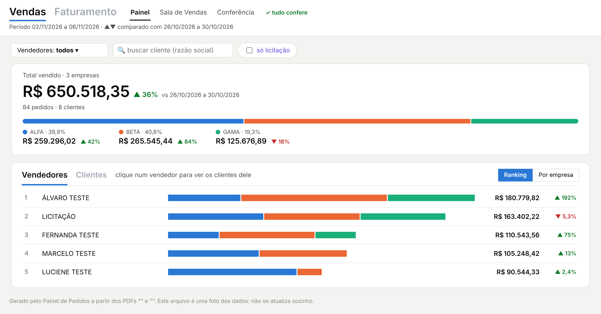

# Painel de Vendas e Faturamento

Programa desktop para Windows que **lê os relatórios em PDF exportados do ERP** e monta sozinho um painel de vendas e faturamento por vendedor, por empresa e por cliente, sem digitar nada em planilha.

Criei este programa quando trabalhava no apoio comercial de uma indústria com três empresas no mesmo grupo. Toda semana os números de cada vendedor eram copiados à mão dos relatórios do ERP para o Excel. O painel passou a ler os PDFs direto e a fazer as somas e comparações automaticamente.

> Os nomes das empresas, vendedores, clientes e todos os valores deste repositório são **fictícios**.



Exemplo do relatório exportado pelo programa: [`docs/demo.html`](docs/demo.html). Baixe e abra no navegador.

## O que ele faz

- **Lê PDFs do ERP** com um extrator de texto de PDF escrito do zero em C#, sem bibliotecas externas (`PdfTexto.cs`). Ele interpreta dois relatórios:
  - Vendas: "Resumo por Vendedor [Pedido]"
  - Faturamento: "Vendas por Vendedor - Sobre Faturamento"
- **Consolida as três empresas**: total geral, participação de cada empresa, ranking de vendedores e clientes de cada vendedor, até chegar aos pedidos e notas.
- **Compara períodos (▲▼)** com o período anterior. Quando o mês ainda está em andamento, compara com os mesmos dias do período anterior.
- **Mantém o histórico**: lê a pasta e as subpastas, separa os PDFs por período e deixa escolher qual período ver, sem misturar meses.
- **Marca vendas de licitação**: clientes de licitação ficam destacados, mas continuam somados ao vendedor, sem contar duas vezes no total.
- **Tem a aba Sala de Vendas**, com a mesma análise só para um grupo de vendedores escolhido.
- **Tem a aba Conferência**, que confere se a soma dos pedidos lidos bate com o total impresso em cada PDF.
- **Exporta para HTML** em um arquivo único e interativo, para mandar por e-mail. As duas áreas, os períodos e os filtros vão junto.
- **Atualiza sozinho** quando um PDF novo é salvo na pasta.

## Tecnologias

- C# (.NET Framework 4.x) e Windows Forms
- Leitura de PDF própria: descompressão de streams, decodificação de texto e reconstrução de linhas pela posição na página
- HTML, CSS e JavaScript puro no relatório exportado (`painel_modelo.html`)

O PC da empresa não permitia instalar nada (Python, IDEs etc.). Por isso o programa usa **só o que já vem no Windows**: ele é compilado pelo `csc.exe` do próprio .NET Framework e não tem nenhuma dependência.

## Estrutura

```
src/
  PdfTexto.cs          extrator de texto de PDF (sem bibliotecas)
  Resumo.cs            interpreta os relatórios e monta pedidos, vendedores e clientes
  Licitacoes.cs        lista de clientes de licitação (comparação tolerante a nomes cortados)
  Exportador.cs        gera o HTML interativo a partir do modelo
  painel_modelo.html   modelo do relatório exportado
  TelaPainel.cs        tela principal (painel, ranking e drill-down)
  Janela.cs            janela, abas, leitura de pastas e atualização automática
  Dialogos.cs          janelas auxiliares
  compilar.bat         compila com o compilador que já vem no Windows
exemplos/
  vendas/              PDFs fictícios do relatório de pedidos (2 semanas)
  faturamento/         PDFs fictícios do relatório de faturamento (2 meses)
docs/
  painel.png, demo.html
```

## Como rodar

**Windows:**
1. Rode `src/compilar.bat`. Ele gera o `PainelPedidos.exe` na pasta acima de `src`.
2. Abra o programa e, em **Escolher pasta dos PDFs...**, aponte para `exemplos/vendas`. Em **Faturamento**, aponte para `exemplos/faturamento`.

**Linux/macOS (Mono):**
```bash
cd src
mcs -target:winexe -resource:painel_modelo.html,PainelPedidos.painel_modelo.html \
    -r:System.Windows.Forms.dll -r:System.Drawing.dll -out:PainelPedidos.exe \
    PdfTexto.cs Resumo.cs Licitacoes.cs Exportador.cs Dialogos.cs TelaPainel.cs Janela.cs
mono PainelPedidos.exe
```

## Autor

**Maickon Santos**: estudante de Análise e Desenvolvimento de Sistemas, em busca de estágio na área de dados.
[LinkedIn](https://www.linkedin.com/in/maickon-santos/) · [GitHub](https://github.com/Maickon0709)
